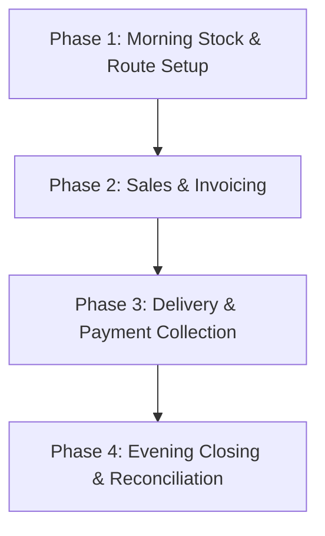

# Distribo - Business Analysis & Strategic Architecture
**Target Market:** FMCG & Grocery Distributors in Bangladesh  
**Document Version:** 1.0  
**Status:** Approved for Architecture Review  

---

## 1. Problem Analysis & Market Reality in Bangladesh

### 1.1 The Ecosystem Context
In Bangladesh, the FMCG (Fast-Moving Consumer Goods) and packaged food/grocery supply chain relies heavily on independent regional distributors (ডিস্ট্রিবিউটর). A distributor typically holds exclusive or non-exclusive territorial distribution rights for brands (e.g., Unilever, PRAN, Square, Meghna Group/Fresh, Akij, ACI, Marico, or regional flour/oil/rice mills) covering 200 to 1,500+ neighborhood retail stores (*Mudir Dokan* / মুদির দোকান, tea stalls, pharmacies, mini-marts).

### 1.2 Core Operational Models
1. **Pre-Selling (Order Booking & Next-Day Delivery):**
   - **Morning:** Field Sales Representatives (SR / DSR) visit assigned market routes (*beats*) to book orders from retailers.
   - **Evening:** Orders are consolidated at the warehouse (*Godown* / গোডাউন).
   - **Next Morning:** Goods are loaded into delivery vans (pickup/rickshaw van/easy-bike) and delivered with a cash memo/invoice.
2. **Ready-Stock Sales (Van Sale / Spot Sale):**
   - Delivery van carries loaded inventory directly to the route. The delivery person/SR takes orders, sells off the van immediately, and prints or writes the cash memo on the spot.
3. **Counter / Direct Wholesale:**
   - Retailers or local sub-dealers come directly to the distributor's depot/godown counter to purchase and transport goods themselves.

### 1.3 Critical Pain Points
* **The "Baki" (Credit) Trap:** 60%–80% of retail distribution operates on credit (*Baki*). Distributors write dues in physical paper *Khatas* (খাতা) or loose memo books. Dues are frequently contested, forgotten, or collected by dishonest field staff without being logged. Working capital dries up.
* **The Multi-Unit Nightmare (Carton vs. Dozen vs. Pcs):** FMCG companies invoice distributors in *Cartons/Cases* (পেটি/কার্টন), but retailers buy in mixed units (e.g., 2 cartons + 5 loose pieces, or 1 dozen + 3 sachets). Manual unit conversions cause calculation errors, lost margins, and inventory count mismatches.
* **Evening Daily Closing (*Hisab-Nikash*):** At 7:00 PM - 9:00 PM, reconciling:
  $$\text{Stock Dispatched} = \text{Stock Sold} + \text{Stock Returned} + \text{Damaged Stock}$$
  $$\text{Total Invoice Amount} = \text{Cash Collected} + \text{MFS (bKash/Nagad)} + \text{New Baki (Credit)} - \text{Discount/Trade Promo}$$
  This process takes 2 to 3 chaotic hours every night with paper calculators, often hiding pilferage.
* **Lack of Tech Literacy:** Typical shopkeepers and godown managers cannot navigate complex English ERPs (SAP, Tally, complex Odoo). They need single-click actions, Bangla terminology, fast keyboard navigation, and mobile-friendly layouts.

---

## 2. Target Users & Personas

### 2.1 Persona 1: The Distributor Owner ("Mahajan" / মহাজন)
* **Demographics:** Age 35–60, uses WhatsApp, bKash, and Facebook on an Android smartphone. Not a tech expert.
* **Primary Goal:** Cash flow safety, knowing total market dues (*Total Baki*), preventing staff theft, checking daily gross profit.
* **Needs:** A high-level daily dashboard on his phone: *Sales Today*, *Cash In Hand*, *Today's Collection*, *Total Market Dues*, *Top 5 Overdue Retailers*.

### 2.2 Persona 2: The Godown Manager / Cashier / Computer Operator
* **Demographics:** Age 22–38, uses a desktop PC or laptop at the godown, moderate tech literacy, very fast at typing numbers on a numpad.
* **Primary Goal:** Creating 100+ invoices fast, receiving stock from supplier trucks, logging daily expenses, closing the evening cash drawer.
* **Needs:** 
  - Rapid search by product name/code (3-5 keystrokes).
  - Quick thermal receipt (3-inch POS) or half-A4 print.
  - Clear, un-editable audit logs.

### 2.3 Persona 3: Sales Representative (SR) / Delivery Man
* **Demographics:** Age 20–32, smartphone user (often budget 4G Android), constantly in the field under heat, dust, and rain.
* **Primary Goal:** Knowing who owes money on today's route (*Beat*), booking orders without paper slips, collecting dues.
* **Needs:** Extremely simple mobile view showing:
  - Route retailer list with their phone number, outstanding due, and last order date.
  - Simple order entry or payment collection entry.

### 2.4 Persona 4: The Retailer / Shopkeeper (*Mudir Dokandar*) - Indirect User
* **Needs:** Clear, tamper-proof proof of payment (SMS / printed memo) showing: *Total Bill*, *Paid Today*, *Remaining Previous Balance*, *Total Due*.

---

## 3. Core User Journeys

### Journey 1: Morning Dispatch & Route Allocation
1. Operator checks inventory availability in Distribo.
2. Operator selects the active route for the day (e.g., "Mirpur-10 Beat - Tuesday").
3. System shows the list of 25 retailers on this beat and their current pending dues.

### Journey 2: Rapid Invoicing (Spot Sale / Counter Sale)
1. Operator types retailer name or phone number. System instantly displays credit status (e.g., *Credit Limit: ৳20,000 | Current Due: ৳14,500*).
2. Operator adds items:
   - Example: "Lux Soap 100g" -> Quantity: 2 Cartons + 12 Pcs.
   - Price automatically calculates based on Carton rate and Piece rate.
3. Invoice Summary:
   - Subtotal: ৳5,400
   - Previous Due: ৳14,500
   - Total Payable: ৳19,900
   - Paid Today: ৳5,000 (Cash) + ৳400 (bKash)
   - Remaining Total Due: ৳14,500
4. Print 1-click memo / Send WhatsApp/SMS summary.

### Journey 3: Separate Payment Collection (Recovering Old Baki)
1. Retailer pays ৳3,000 towards an old pending balance without buying new goods.
2. Operator opens **"Due Collection"** -> Selects Retailer -> Enters ৳3,000 -> Selects Method (Cash / bKash).
3. System automatically creates a Money Receipt (MR), updates the customer ledger, and decreases total market outstanding.

### Journey 4: Evening Closing & Cash Drawer Reconciliation
1. At closing, the Manager opens **"Daily Closing (দৈনিক হিসাব)"**.
2. Distribo generates a clean reconciliation summary:
   - Total Gross Sales (মোট বিক্রি)
   - Total Cash Collected from Sales (নগদ আদায়)
   - Total Old Dues Collected (বাকি আদায়)
   - Total MFS (bKash/Nagad) Collected
   - Daily Godown Expenses (চা/নাস্তা/পরিবহন খরচ)
   - **Net Cash to Hand Over to Owner**
3. Owner verifies and clicks "Lock Daily Register".

---

## 4. Business Rules & Edge Cases

| Area | Business Rule / Requirement | Edge Case Handling |
| :--- | :--- | :--- |
| **UOM Conversion** | 1 Carton = $N$ Pieces (e.g., 1 Carton = 24 Pcs). Price can be set per carton and per piece. | Retailer returns 5 loose pieces. System adjusts piece inventory and updates the unit price proportionally without breaking carton math. |
| **Credit Ceiling** | Each retailer has a defined Credit Limit (বাকি লিমিট) (e.g., ৳15,000) and Max Due Days (e.g., 14 days). | If current due exceeds limit, system shows a prominent RED alert. For MVP, allow Owner/Manager override with a warning. |
| **Payment Splitting** | Transactions often combine multiple payment methods (e.g., ৳2,000 Cash + ৳1,500 bKash + ৳3,000 Baki). | Invoicing engine must support split payments per invoice (Cash, bKash/Nagad, Credit). |
| **Stock Shortage** | Selling item with 0 or negative stock. | FMCG distributors sometimes sell goods before entering the vendor purchase bill. In MVP, system can allow **Negative Stock Warning** (configurable toggle: allow with warning vs. strict block). |
| **Sales Return / Damages** | Damaged, expired, or unsold items returned from retailer. | Must be classified as either **Resellable Stock Return** (adds back to main inventory) or **Damage / Wastage** (routed to a damage quarantine account for claim from FMCG company). |
| **Price Revision** | FMCG manufacturers revise MRP and wholesale rates frequently (e.g., edible oil, milk powder). | Price changes must apply to future invoices only. Old invoices, ledger entries, and past reports must remain immutable. |

---

## 5. Risk Assessment & Mitigation

1. **Risk: Poor Connectivity in Upazila / Rural Markets**
   - *Mitigation:* The MVP web application must be lightweight (sub-1MB asset bundle), responsive, and optimized for low-bandwidth 3G/4G connections.
2. **Risk: Inconsistent Inventory due to Manual Overrides**
   - *Mitigation:* Every inventory change must have a recorded transaction type (`PURCHASE`, `SALE`, `RETURN_DAMAGE`, `RETURN_RESTOCK`, `ADJUSTMENT`). No silent database updates.
3. **Risk: Cashier / Staff Pilferage**
   - *Mitigation:* Invoices cannot be permanently deleted once saved; only "Cancelled" with an audit reason and timestamp.
4. **Risk: 15-Day Timeline Creep**
   - *Mitigation:* Strict MoSCoW scoping. Cut automated accounting ledgers (debit/credit double entry), multi-warehouse routing, and complex promotion matrix from the 15-day MVP. Use single-entry customer ledger and flat discount fields.
