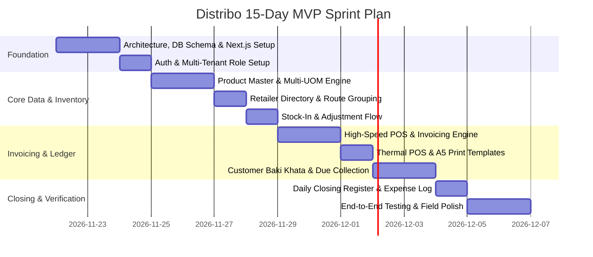

# 15-Day MVP Scope & Implementation Roadmap
## Product: Distribo (ডিস্ট্রিবিউটো)

---

## 1. MoSCoW Scope Prioritization

To launch a commercially viable, reliable MVP within **15 days**, features are ruthlessly prioritized:

### 🟢 MUST-HAVE (Included in 15-Day Scope)
1. **Multi-Tenant Distributor Account Setup:** Company info, logo/header for invoice printing, currency (BDT ৳).
2. **Product Catalog & Dual-UOM Inventory:**
   - Products with Carton + Piece conversions (e.g., 1 carton = 24 pcs).
   - Purchase rate, wholesale rate, MRP.
   - Stock-In (Purchase bill entry) and live inventory count.
3. **Retailer Directory with Routes (Beats):**
   - Shop name, owner name, phone, address, assigned route.
   - Credit limit and current balance tracking.
4. **Fast POS Invoicing:**
   - Instant search for retailer & products.
   - Carton + Piece quantity entry.
   - Split payment (Cash, bKash/MFS, Credit/Baki).
   - Instant 3-inch (80mm) thermal & A5 invoice printout.
   - Automatic deduction from stock and addition to customer credit.
5. **Standalone Due Collection (বাকি আদায়):**
   - Quick payment modal to collect outstanding dues from retailers.
   - Generates Money Receipt (MR) and updates customer ledger.
6. **Customer Ledger ("Baki Khata"):**
   - Chronological ledger per customer showing debits, credits, and running balance.
   - 1-click printable/exportable statement.
7. **Daily Closing & Reconciliation (দৈনিক হিসাব):**
   - End-of-day summary: Total Sales, Cash collected, Due collected, MFS collected, Petty expenses, and Net Cash in Hand.
   - Simple petty expense logging (tea, labor, transport).
8. **Bilingual UI (Bangla & English labels):**
   - Clear, familiar terminology for Bangladeshi operators.

---

### 🟡 SHOULD-HAVE (Deferred to Phase 2 - Post-MVP)
* Field SR dedicated Android App with GPS check-in.
* Automated SMS gateway integration (e.g., Greenweb/BulkSMSBD) - *MVP provides 1-click copyable WhatsApp/SMS text format*.
* Automated batch/expiry date tracking per carton.
* Barcode scanning with dedicated handheld scanners.
* Advanced multi-tier promotional schemes (e.g., "Buy 10 cartons get 1 carton free + 2% cash discount").

---

### 🔴 WON'T-HAVE (Out of Scope for 15 Days)
* Full double-entry general ledger accounting (balance sheets, profit-and-loss journal vouchers).
* Multi-warehouse inter-depot transfers.
* Vehicle GPS tracking and route optimization.
* Direct bank API integration.

---

## 2. 15-Day Day-by-Day Sprint Schedule

### Sprint Breakdown:
* **Day 1–2: Architecture & Foundation**
  - Project setup (Next.js, Tailwind, Prisma, PostgreSQL).
  - Multi-tenant data schema (Distributors, Users, Roles).
  - Global styling, responsive layout shell, Bangla font configuration (Hind Siliguri / Noto Sans Bengali).
* **Day 3: Authentication & Role Management**
  - Phone/Password or Email login for Owner, Manager, and SR.
  - Role-based route guards and permissions.
* **Day 4–5: Product Catalog & Dual-UOM Engine**
  - Product CRUD with dual units (Carton $\leftrightarrow$ Piece calculation).
  - Bulk CSV product import template (crucial for quick distributor onboarding).
  - Minimum stock alerts.
* **Day 6: Retailer & Route (Beat) Management**
  - Retailer CRUD with opening due balances and route assignment.
  - Route filter and search view.
* **Day 7: Stock-In & Inventory Ledger**
  - Inward stock receipt from supplier.
  - Live stock level table with carton/piece display.
* **Day 8–9: High-Speed Billing Engine (The Core)**
  - Rapid keyboard-friendly POS screen.
  - Real-time stock decrement, previous due injection, split-payment calculation.
  - Invoice save and transaction atomicity.
* **Day 10: Thermal & A5 Receipt Printing Engine**
  - Optimized CSS print media formatting for 80mm/58mm thermal rolls and half-A4 pages.
  - WhatsApp/SMS summary generator.
* **Day 11–12: Customer Khata & Due Collection Engine**
  - Dedicated retailer ledger page with running balance calculation.
  - "Receive Payment" modal with Money Receipt (MR) generation.
  - Overdue debtor list sorted by aging and amount.
* **Day 13: Daily Closing Register & Expense Logging**
  - Automated end-of-day summary calculation.
  - Petty expense tracker (tea, labor, van fuel).
  - Register lock mechanism.
* **Day 14: End-to-End Stress & Workflow Testing**
  - Simulate 200 invoices, stock reconciliations, and split payments.
  - Edge case checks (negative stock, returns, partial payments).
* **Day 15: Field Polish & Commercial Launch Readiness**
  - Performance tuning (sub-second queries).
  - Seed dummy FMCG demo data for instant client demos.
  - Deployment on production environment.

---

## 3. Definition of Done (DoD) for MVP
1. A distributor can upload their product list via CSV or UI in under 15 minutes.
2. A biller can issue a multi-item invoice in under 30 seconds and print it on an 80mm thermal printer.
3. Every invoice immediately reflects on the inventory count and retailer's Baki Khata.
4. Collecting a past due immediately logs cash and adjusts customer balance.
5. The daily closing report accurately sums up all cash, MFS, and credits with zero discrepancy.
