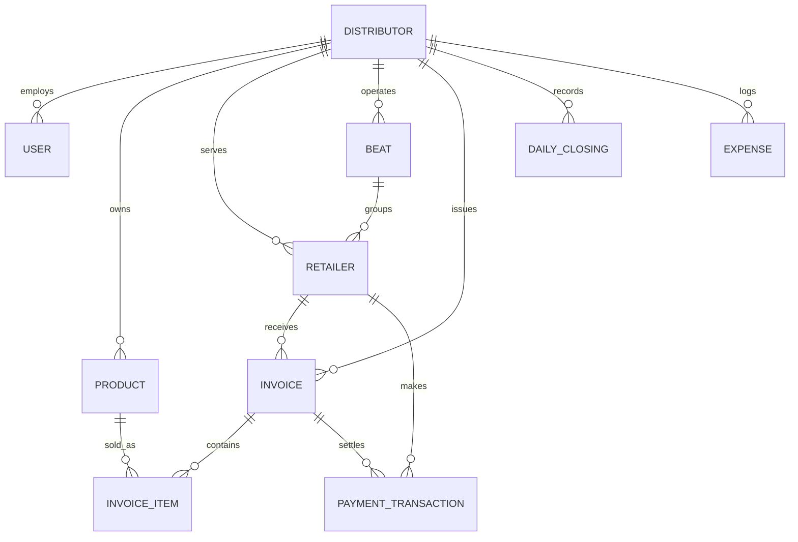

# Product Requirements Document (PRD)
## Project Name: Distribo (ডিস্ট্রিবিউটো)
**Document Version:** 1.0  
**Target Completion:** 15-Day Commercial MVP  
**Target Market:** Bangladeshi FMCG & Grocery Distributors  

---

## 1. Executive Summary & Objective

**Distribo** is an ultra-fast, simplified Cloud/Web SaaS inventory, billing, credit (বাকি), and collection management platform tailored specifically for the fast-paced, high-volume reality of FMCG and grocery distributors in Bangladesh.

The MVP objective is to eliminate paper-based memo errors, stop credit leakage, automate daily evening cash reconciliation (*দৈনিক হিসাব-নিকাশ*), and provide clear visibility over stock and receivables without overwhelming non-technical warehouse operators.

---

## 2. Key Success Metrics (MVP Goals)
1. **Invoice Speed:** An operator can generate and print a full multi-item invoice in **under 30 seconds**.
2. **Reconciliation Time:** Evening daily closing reduced from 2.5 hours to **under 15 minutes**.
3. **Credit Transparency:** Zero disputes over customer outstanding balances; instant ledger printout / WhatsApp summary available per retailer.
4. **Learning Curve:** A typical godown computer operator can operate the system with **less than 1 hour** of training.

---

## 3. User Roles & Permission Matrix (RBAC)

| Role | Permissions & Capabilities | Restrictions |
| :--- | :--- | :--- |
| **Owner / Admin** (মালিক) | Full system access: add/edit products & purchase rates, adjust stock, view gross profits, override credit limits, cancel invoices, view master reports, manage staff accounts. | None. |
| **Manager / Biller** (ম্যানেজার / অপারেটর) | Create invoices, record stock-in (purchases), log payment collections, view retailer balances, print receipts, run daily closing report. | Cannot see product cost/purchase price or profit margins (optional toggle); cannot delete/cancel approved invoices without owner approval. |
| **Field SR / Delivery** (এসআর / ডেলিভারি ম্যান) | Mobile-optimized view: view retailer list on assigned route/beat, view retailer credit due, record new order or payment collected. | Cannot modify base product prices or view overall distributor financials. |

---

## 4. MVP Functional Specifications

### Module 1: Product & Inventory Management
* **1.1 Product Master:**
  * Product Name (English & optional Bangla: e.g., "Surf Excel 500g / সার্ফ এক্সেল ৫০০ গ্রাম").
  * Brand / Category (e.g., Unilever, Square, Beverage, Biscuits).
  * Unit Hierarchy / Multi-UOM:
    * Primary Unit (Carton / Peti / কেস).
    * Sub-Unit (Piece / Pcs / প্যাকেট).
    * Conversion Factor (e.g., 1 Carton = 24 Pcs).
  * Pricing:
    * Purchase Cost (per Carton & calculated per Pc).
    * Wholesale / Selling Price (per Carton & per Pc).
    * MRP (Maximum Retail Price).
  * Minimum Stock Alert Threshold (Warns when stock falls below $X$ Cartons).
* **1.2 Stock In (Purchase Inward):**
  * Record incoming shipment from manufacturer / super-distributor.
  * Vendor/Company Name, Invoice/Challan Number, Date.
  * Add Items (Quantity in Cartons + Pcs, Unit Cost).
  * Auto-updates warehouse stock balance and records average purchase cost.
* **1.3 Stock Adjustment & Damage Quarantine:**
  * Adjust stock for physical count reconciliation, warehouse breakage, or expiration.
  * Categories: `Physical Discrepancy`, `Damage/Expired` (moves to non-sellable return pool).

---

### Module 2: Retailers & Beat (Route) Management
* **2.1 Retailer Profile:**
  * Shop Name (দোকানের নাম), Owner Name, Mobile Number (Used for SMS/WhatsApp memos).
  * Market / Route / Beat (e.g., "Rampura Main Road", "Chawkbazar Lane").
  * Opening Balance (Initial Baki when onboarding existing distributor data).
  * Credit Limit (৳ Taka ceiling, e.g., ৳25,000).
  * Active/Inactive status.
* **2.2 Beat / Route Organization:**
  * Assign retailers to beats for structured daily visits (e.g., Sunday: Beat A, Monday: Beat B).
  * Filter retailer list and outstanding dues by Route.

---

### Module 3: Sales, Invoicing & Billing Engine (Core Heart of Distribo)
* **3.1 Rapid POS / Invoice Creation:**
  * Auto-focused quick search bar: Search retailer by Name, Shop Name, Phone, or Route.
  * Instant Customer Due Badge: Displays `Previous Due: ৳12,400 | Limit: ৳20,000`.
  * High-speed Item Entry:
    * Search product by typing 2-3 letters.
    * Enter quantity as **Cartons + Pieces** (e.g., typing `2` in Ctn and `6` in Pcs auto-calculates total price seamlessly).
    * Real-time validation against stock balance.
  * Instant discount field (Flat ৳ or %).
* **3.2 Financial Breakdown & Payment Split:**
  * Current Bill Subtotal.
  * $(+)$ Previous Outstanding Due.
  * Total Net Payable.
  * Payment Input:
    * Paid Amount (নগদ / bKash / Nagad).
    * Remaining Balance auto-adds to Retailer's Khata (Baki).
* **3.3 Output & Printing:**
  * **Thermal POS Print (3-inch / 80mm):** Compact Bangla/English receipt with Distributor Name, Address, Phone, Invoice No, Items, Bill, Paid, and Net Due.
  * **Standard A5 / Half-A4 Format:** For delivery van documentation.
  * **WhatsApp/SMS Text Generator:** Instant 1-click text string: *"ভাই, মেমো #১০২৪: বিল ৳৫,০০০, জমা ৳২,০০০, বর্তমান বাকি ৳৮,৫০০। ধন্যবাদ - ডিস্ট্রিবিউটো"*.

---

### Module 4: Customer Credit & "Baki Khata" Ledger
* **4.1 Dedicated Customer Ledger (খাতা):**
  * Complete chronological ledger per retailer.
  * Columns: `Date`, `Description / Invoice #`, `Debit (Bill Amount)`, `Credit (Paid Amount)`, `Running Balance Due`.
  * 1-click PDF/Printable Statement for resolving retailer disputes.
* **4.2 Due Collection Entry (বাকি আদায়):**
  * Standalone collection modal: Select Retailer -> Enter Amount Paid -> Select Method (Cash / bKash / Cheque) -> Add Note/Ref -> Print Money Receipt (MR).
  * Instantly reduces retailer's balance and injects cash into today's daily closing register.
* **4.3 Market Dues Aging & Risk List:**
  * High-level list of all debtors sorted by:
    * Highest Outstanding Amount.
    * Longest Inactive / Overdue Days (>15 days, >30 days).

---

### Module 5: Daily Closing & Reconciled Business Reports
* **5.1 Evening Daily Closing Register (দৈনিক হিসাব ও ক্লোজিং):**
  * Consolidates the day's financials into a single tamper-evident screen:
    * **Gross Sales (মোট বিক্রি):** Total value of goods sold today.
    * **Cash from Sales (নগদ বিক্রি):** Direct cash collected from today's invoices.
    * **Due Recoveries (বাকি আদায়):** Cash collected today for past invoices.
    * **MFS Receipts (bKash/Nagad):** Digital payments received today.
    * **New Credit Given (নতুন বাকি):** Total credit extended today.
    * **Daily Godown Expenses (দৈনিক খরচ):** Petty cash out (Labour, Tea, Van fare).
    * **Expected Cash in Hand (হাতে নগদ):** $\text{Cash from Sales} + \text{Due Recoveries} - \text{Daily Expenses}$.
  * "Close Register" button: Locks the day's financial snapshot.
* **5.2 Core Operational Reports (1-Click Exportable):**
  * **Daily Sales Sheet:** Invoice-wise summary with breakdown.
  * **Product-Wise Sales Summary:** Total cartons and pcs sold per SKU today (essential for stock replenishment).
  * **Current Stock Valuation:** Total units on hand $\times$ purchase price.

---

## 5. Non-Functional & Technical Architecture Requirements

### 5.1 Usability & UX for Bangladesh
* **Language Support:** Bilingual design. Key terms displayed in clear Bengali alongside English (*বিক্রি / Sale*, *বাকি / Due*, *জমা / Paid*, *খরচ / Expense*, *স্টক / Stock*).
* **Keyboard-First Design:** Operators at desktop counters must be able to complete an invoice using `Tab`, `Enter`, and Arrow keys without touching the mouse.
* **Visual Clarity:** Green for Payments/Joma, Red for Baki/Due, bold numbers with the Bangladeshi Taka symbol (৳).

### 5.2 Technical Stack Recommendation (For 15-Day Delivery)
* **Frontend:** Next.js (React) + Tailwind CSS + Lucide Icons + Shadcn UI.
* **Backend / API:** Next.js Server Actions / API Routes (Node.js).
* **Database:** PostgreSQL (via Supabase or Neon) with Prisma ORM.
* **Deployment:** Vercel (Edge network) with zero DevOps overhead.
* **Printing:** Client-side CSS print media queries for instant 80mm thermal and A5 printing without external drivers.

---

## 6. Core Database Entity-Relationship Diagram (ERD)

---

## 7. Audit & Anti-Fraud Controls
1. **No Hard Deletes:** Invoices and payment records cannot be deleted. If a mistake occurs, the system records a `CANCELLED` status with mandatory notes and auto-reverses stock and ledger balances.
2. **Immutable Ledgers:** Customer balance is derived from transaction logs or locked closing balances, preventing arbitrary balance editing.
3. **Daily Register Lock:** Once the daily closing is signed off by the Owner/Manager, previous day invoices cannot be backdated or modified without explicit admin unlocking.
