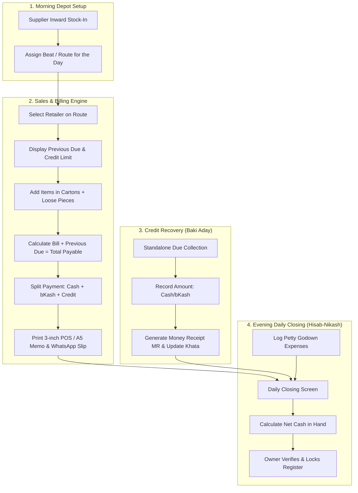
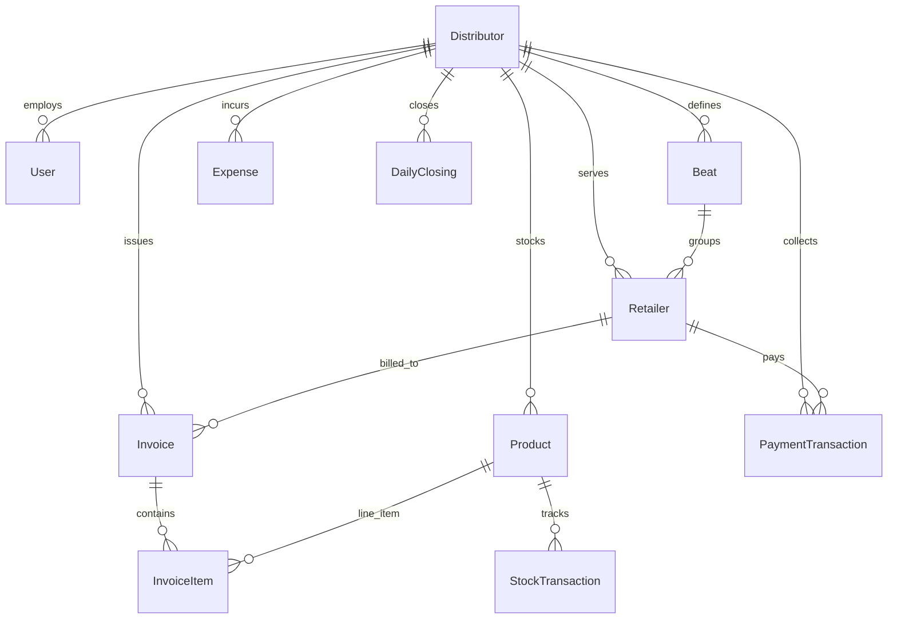
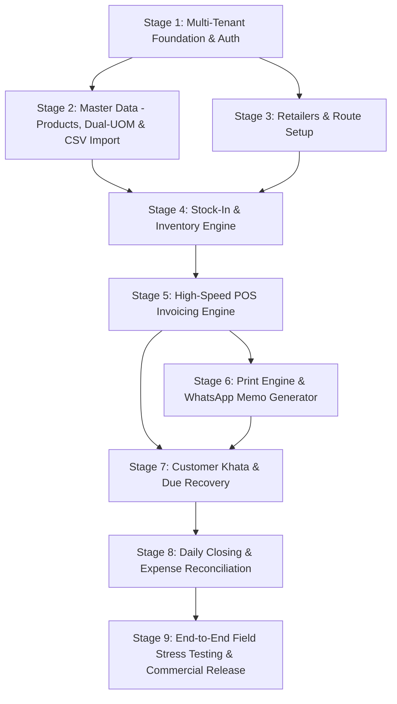

# Project Readiness Report: Distribo (ডিস্ট্রিবিউটো)
**Role:** Senior Software Architect, Technical Lead & Implementation Engineer  
**Date:** November 22, 2026  
**Status:** Architecture Review Complete & Ready for Step-by-Step Approval  
**File Location:** `docs/PROJECT_READINESS_REPORT.md`

---

## 1. Executive Summary & Product Understanding

**Distribo** is a purpose-built, multi-tenant vertical SaaS platform designed specifically for fast-moving consumer goods (FMCG) and packaged grocery distributors in Bangladesh. 

Unlike standard accounting ERPs (Tally, SAP, QuickBooks) or generic retail POS systems, Distribo addresses the operational realities of the Bangladeshi distribution depot (*Godown*):
* High-speed counter and route delivery invoicing (sub-30-second turnaround).
* Deep structural dependence on customer credit (*Baki*) accounting without the overhead of double-entry ledger complexity.
* Dual-unit of measure arithmetic (Carton $\leftrightarrow$ Piece conversions).
* Evening cash drawer reconciliation (*Hisab-Nikash*) matching invoiced values, physical cash, digital mobile financial services (bKash/Nagad), and petty warehouse expenses.

**Core Directives Acknowledged:**
* **Strict Scope Adherence:** The 15-day MVP scope defined in the approved documentation is fixed. No feature creep, no unapproved dependencies, no overengineering.
* **Code Freeze:** No production code will be written or modified until this report and the Day-1 implementation plan are explicitly approved.
* **Workflow Cadence:** Work will proceed one day at a time with review checkpoints, risk explanations, and acceptance verification at every phase.

---

## 2. Target Users & Problem Mapping

| Target Persona | Operational Context | Primary Pain Points Solved | MVP Solution |
| :--- | :--- | :--- | :--- |
| **Distributor Owner** (*Mohajon* / মহাজন) | Manages business via smartphone; low tech-literacy, high commercial acumen. | Cash pilferage, forgotten credit, unknown market dues (*Total Baki*), unverified staff claims. | Single-screen mobile dashboard: Today’s Sales, Cash in Hand, Total Market Baki, Top 5 Debtors, and Daily Closing sign-off. |
| **Godown Manager / Biller** (কম্পিউটার অপারেটর) | Operates a desktop PC/laptop in a noisy, fast-paced warehouse counter. | Typing speed bottleneck during peak morning/evening hours; manual Carton-to-Piece math errors; end-of-day math discrepancies. | Numpad/keyboard-first POS screen; dual-UOM auto-calculation; 1-click 3-inch thermal POS printing; automated daily reconciliation sheet. |
| **Field SR / Delivery Assistant** (এসআর / ডেলিভারি ম্যান) | In the field on market beats; smartphone user with spotty 3G/4G connectivity. | Paper memo books getting damaged/lost; retailer disputes over previous payments; lack of route customer due lists. | Mobile-responsive beat/route list showing customer names, phone numbers, and live due balances; ability to log cash collected. |
| **Retailer / Dokandar** (*Mudir Dokan* / মুদির দোকানদার) | Neighborhood grocery store owner (Beneficiary). | Unclear handwritten paper memos; disagreements on old unpaid balances. | Unambiguous printed receipts or instant 1-click WhatsApp/SMS text memos showing: *Bill + Previous Due - Paid = Balance Due*. |

---

## 3. Core Business Workflows



### Critical Financial Invariants:
1. **At Invoicing:**
   $$\text{Total Invoiced} = \text{Cash Collected} + \text{MFS Collected (bKash/Nagad)} + \text{New Credit (Baki Added)}$$
2. **Customer Balance Progression:**
   $$\text{New Due Balance} = \text{Previous Balance} + \text{Current Invoice Total} - \text{Payments Made Today}$$
3. **Evening Cash Drawer Equilibrium:**
   $$\text{Expected Cash in Hand} = (\text{Invoice Cash Collected}) + (\text{Old Due Recoveries in Cash}) - (\text{Approved Petty Expenses})$$

---

## 4. Approved MVP Features (MoSCoW Guardrails)

### Included in 15-Day Scope (Strict Must-Haves)
1. **Multi-Tenant Account Foundation:** Distributor profile, address, phone, receipt header, currency (BDT ৳).
2. **Product Master & Dual-UOM Inventory:**
   - Products with primary unit (*Carton/Case*) and secondary unit (*Piece/Packet*).
   - Dynamic conversion factor ($1 \text{ Carton} = N \text{ Pieces}$).
   - Purchase rate, wholesale selling rate, MRP.
   - Stock-in inward entry (supplier challan) and live stock deduction.
   - Bulk CSV product import (essential for fast customer onboarding).
3. **Retailer Directory & Route (Beat) Organization:**
   - Retailer profile, phone, beat/market name, opening balance, credit ceiling.
   - Filterable route list for daily dispatch.
4. **Fast POS Billing Engine:**
   - Sub-30-second keyboard-friendly screen.
   - Auto-display of previous customer due.
   - Carton + piece quantity entry.
   - Split payment (Cash, bKash/Nagad, Credit).
   - 3-inch (80mm) thermal receipt format and standard A5 half-page layout.
   - 1-click WhatsApp/SMS text generator.
5. **Customer Credit Ledger ("Baki Khata") & Due Collection:**
   - Chronological debit/credit running balance per retailer.
   - Standalone "Due Collection" modal with Money Receipt (MR) generation.
   - Overdue debtor aging summary.
6. **Daily Closing & Reconciliation (*Hisab-Nikash*):**
   - Consolidated daily screen (Sales, Cash, Baki, MFS, Expenses, Expected Cash in Hand).
   - Petty expense logger (labor, tea, van fuel).
   - Tamper-resistant register locking mechanism.
7. **Bilingual UI:** Bengali labels alongside English for low-literacy operators (*বিক্রি, বাকি, জমা, খরচ, স্টক*).

### Explicitly Excluded from 15-Day MVP (No Scope Creep)
* Native Android APK / Offline SQLite sync (web app will be mobile-responsive).
* Third-party SMS gateway API integration (MVP uses 1-click copyable WhatsApp/SMS text format).
* Barcode scanner hardware integration.
* Batch and expiration date tracking per carton.
* Multi-tier brand promotional matrix (e.g., "Buy 10 cartons get 1 carton free + 2% cash rebate").
* Double-entry general ledger accounting (P&L journals, balance sheets).

---

## 5. Proposed Technical Architecture

```
┌─────────────────────────────────────────────────────────────┐
│                    Client Tier (Browser)                    │
│  • Next.js 14+ (App Router, React, TypeScript)              │
│  • Tailwind CSS + Lucide Icons + Shadcn UI                  │
│  • Keyboard navigation hooks for high-speed POS billing     │
│  • CSS @media print engine (80mm Thermal & A5 Half-Page)    │
└──────────────────────────────┬──────────────────────────────┘
                               │ HTTPS / JSON / Server Actions
┌──────────────────────────────▼──────────────────────────────┐
│                    Application & API Tier                   │
│  • Next.js Server Actions & Route Handlers                  │
│  • Multi-Tenant Session Middleware (Tenant Scoping)         │
│  • Zod Validation Pipeline (Strict data schemas)            │
│  • Exact-Precision Financial Logic (Decimal.js / BigInt)    │
└──────────────────────────────┬──────────────────────────────┘
                               │ Prisma ORM
┌──────────────────────────────▼──────────────────────────────┐
│                    Data Persistence Tier                    │
│  • PostgreSQL (Supabase / Neon / Local PostgreSQL)          │
│  • Row-Level Multi-Tenancy (distributorId foreign keys)      │
│  • ACID Transactional Guarantees for Billing & Stock Decr.  │
└─────────────────────────────────────────────────────────────┘
```

### Architectural Design Principles:
1. **Zero-Dependency Printing:** Thermal receipt printing will be implemented via optimized CSS `@media print` rules. No proprietary ESC/POS printer drivers, browser extensions, or local print servers required.
2. **Exact-Precision Decimal Arithmetic:** JavaScript floating-point errors (e.g., `0.1 + 0.2 = 0.30000000000000004`) cannot exist in financial calculations. All monetary fields and stock calculations will use Prisma `Decimal` backed by PostgreSQL `DECIMAL(12,2)`.
3. **Atomic Financial Transactions:** Creating an invoice requires 3 database actions: (a) Insert `Invoice` and `InvoiceItem`, (b) Decrement `Product.currentStockPieces`, and (c) Increment `Retailer.currentDue`. These will execute inside a single atomic `prisma.$transaction` block. If any step fails, the entire transaction rolls back.

---

## 6. Database Entities & Relational Schema



### Core Table Definitions

1. **`Distributor`** (Tenant Root)
   - `id`: UUID (Primary Key)
   - `name`: String (e.g., "M/S Bismillah Enterprise")
   - `phone`: String (Unique, primary contact)
   - `address`: String
   - `receiptHeader`: String (Print custom memo header)
   - `currency`: String (Default "BDT")
   - `createdAt`, `updatedAt`: DateTime

2. **`User`**
   - `id`: UUID (Primary Key)
   - `distributorId`: UUID (Foreign Key $\rightarrow$ `Distributor.id`)
   - `name`: String
   - `phone`: String (Unique per tenant)
   - `passwordHash`: String
   - `role`: Enum (`OWNER`, `MANAGER`, `SR`)
   - `isActive`: Boolean

3. **`Beat`** (Route)
   - `id`: UUID (Primary Key)
   - `distributorId`: UUID (Foreign Key)
   - `name`: String (e.g., "Rampura Main Road", "Badda Beat")
   - `dayOfWeek`: String (Optional route scheduling)

4. **`Retailer`**
   - `id`: UUID (Primary Key)
   - `distributorId`: UUID (Foreign Key)
   - `beatId`: UUID (Foreign Key $\rightarrow$ `Beat.id`, Nullable)
   - `shopName`: String (দোকানের নাম)
   - `ownerName`: String
   - `phone`: String
   - `address`: String
   - `creditLimit`: Decimal (Default 0.00)
   - `openingBalance`: Decimal (Default 0.00)
   - `currentDue`: Decimal (Default 0.00)
   - `isActive`: Boolean

5. **`Product`**
   - `id`: UUID (Primary Key)
   - `distributorId`: UUID (Foreign Key)
   - `name`: String (English name)
   - `banglaName`: String (Optional Bengali name)
   - `brand`: String (e.g., "Unilever", "Square", "PRAN")
   - `category`: String
   - `uomPrimary`: String (Default "Carton")
   - `uomSub`: String (Default "Pcs")
   - `conversionFactor`: Integer (e.g., 24 pcs per carton)
   - `purchaseCost`: Decimal (Cost per carton)
   - `wholesalePrice`: Decimal (Selling price per carton)
   - `mrp`: Decimal (Optional MRP per piece)
   - `minStockAlert`: Integer (Pieces threshold)
   - `currentStockPieces`: Integer (Stock tracked in lowest unit: pieces)

6. **`StockTransaction`** (Audit Trail)
   - `id`: UUID (Primary Key)
   - `distributorId`: UUID (Foreign Key)
   - `productId`: UUID (Foreign Key $\rightarrow$ `Product.id`)
   - `type`: Enum (`PURCHASE_IN`, `SALE_OUT`, `RETURN_RESTOCK`, `DAMAGE_OUT`, `ADJUSTMENT`)
   - `quantityPieces`: Integer (Signed: positive for in, negative for out)
   - `referenceId`: String (Invoice ID, Challan ID, or manual note)
   - `createdAt`: DateTime

7. **`Invoice`**
   - `id`: UUID (Primary Key)
   - `distributorId`: UUID (Foreign Key)
   - `retailerId`: UUID (Foreign Key $\rightarrow$ `Retailer.id`)
   - `invoiceNumber`: String (Sequential per distributor, e.g., `INV-2026-0001`)
   - `subtotal`: Decimal
   - `discount`: Decimal (Default 0.00)
   - `totalAmount`: Decimal (Subtotal - Discount)
   - `previousDue`: Decimal (Due snapshot at invoice creation time)
   - `grandTotal`: Decimal (TotalAmount + PreviousDue)
   - `paidAmount`: Decimal (Total paid now)
   - `cashAmount`: Decimal
   - `mfsAmount`: Decimal
   - `mfsProvider`: String (Nullable: "bKash", "Nagad", etc.)
   - `dueAmount`: Decimal (GrandTotal - PaidAmount)
   - `status`: Enum (`COMPLETED`, `CANCELLED`)
   - `cancellationReason`: String (Nullable)
   - `createdById`: UUID (Foreign Key $\rightarrow$ `User.id`)
   - `createdAt`: DateTime

8. **`InvoiceItem`**
   - `id`: UUID (Primary Key)
   - `invoiceId`: UUID (Foreign Key $\rightarrow$ `Invoice.id`)
   - `productId`: UUID (Foreign Key $\rightarrow$ `Product.id`)
   - `cartonQty`: Integer
   - `pieceQty`: Integer
   - `totalPieces`: Integer
   - `unitPricePerPiece`: Decimal
   - `totalPrice`: Decimal

9. **`PaymentTransaction`** (Money Receipt / Baki Aday)
   - `id`: UUID (Primary Key)
   - `distributorId`: UUID (Foreign Key)
   - `retailerId`: UUID (Foreign Key $\rightarrow$ `Retailer.id`)
   - `invoiceId`: UUID (Foreign Key $\rightarrow$ `Invoice.id`, Nullable if standalone due collection)
   - `mrNumber`: String (Sequential Money Receipt #)
   - `amount`: Decimal
   - `paymentMethod`: Enum (`CASH`, `BKASH`, `NAGAD`, `BANK`)
   - `notes`: String (Nullable)
   - `createdById`: UUID (Foreign Key $\rightarrow$ `User.id`)
   - `createdAt`: DateTime

10. **`Expense`** (Daily Godown Petty Cash)
    - `id`: UUID (Primary Key)
    - `distributorId`: UUID (Foreign Key)
    - `category`: Enum (`LABOR`, `TEA_SNACKS`, `TRANSPORT`, `RENT`, `OTHER`)
    - `amount`: Decimal
    - `notes`: String
    - `date`: DateTime
    - `createdById`: UUID (Foreign Key $\rightarrow$ `User.id`)

11. **`DailyClosing`**
    - `id`: UUID (Primary Key)
    - `distributorId`: UUID (Foreign Key)
    - `closingDate`: DateOnly
    - `grossSales`: Decimal
    - `cashCollected`: Decimal
    - `dueCollected`: Decimal
    - `mfsCollected`: Decimal
    - `expensesTotal`: Decimal
    - `netCashInHand`: Decimal
    - `status`: Enum (`OPEN`, `LOCKED`)
    - `closedById`: UUID (Foreign Key $\rightarrow$ `User.id`)
    - `closedAt`: DateTime

---

## 7. Security & Multi-Tenancy Considerations

1. **Row-Level Tenant Isolation:**
   - Multi-tenancy will be strictly enforced at the data layer. Every database table (except the system admin catalog) carries a mandatory `distributorId`.
   - All server actions and repository queries will automatically derive the `distributorId` from the authenticated session context. No client-supplied tenant ID can ever be trusted.
2. **Audit Trails & Financial Anti-Fraud:**
   - **No Hard Deletes:** Invoices, payment transactions, and stock logs cannot be deleted from the database.
   - When an invoice is cancelled, the system creates an explicit offsetting stock transaction (`RETURN_RESTOCK`) and adjusts the customer's `currentDue` balance with a logged audit timestamp and mandatory cancellation note.
3. **Register Locking Guardrail:**
   - Once a `DailyClosing` record is set to `LOCKED`, retroactive additions, edits, or cancellations of transactions on that closing date are strictly blocked unless unlocked by an `OWNER` with a recorded audit log.
4. **Bangladeshi Mobile Phone Sanitization:**
   - Phone numbers will be sanitized and validated using the standard format: `^(?:\+8801|01)[3-9]\d{8}$`.

---

## 8. Dependencies & Implementation Sequence



### Dependency Analysis:
* POS Invoicing cannot be built before the Dual-UOM Product Engine and Retailer Directory are verified.
* Customer Ledger (*Baki Khata*) depends on both Invoicing and Standalone Due Collection transactions.
* Daily Closing relies on the completed outputs of Invoices, Due Collections, and Petty Expenses.

---

## 9. Missing Decisions & Conflicting Requirements (Action Required)

To ensure zero ambiguity before implementation begins, please clarify these five operational decisions:

1. **Negative Stock Policy at Billing:**
   - In Bangladesh, delivery trucks often arrive at the godown and goods are loaded onto delivery vans before the operator has finished entering the supplier's purchase invoice.
   - *Decision:* Should Distribo **strictly block** billing when stock reaches 0, or display a **prominent warning** and permit negative stock (with automated reconciliation once the purchase bill is entered)? *(Recommended: Allow with warning for MVP, configurable by Owner).*
2. **Credit Limit Enforcement:**
   - When a retailer reaches their credit ceiling (e.g., ৳20,000 limit reached):
   - *Decision:* Should the system **strictly lock** invoice creation for that customer, or **show an urgent red badge** and permit the Owner/Manager to proceed? *(Recommended: Red badge with soft warning for MVP to avoid stalling real-time sales).*
3. **Authentication Strategy:**
   - Godown operators and distributors rarely use email.
   - *Decision:* Should login credentials be **Phone Number + Password** or **Email + Password**? *(Recommended: Phone Number + Password).*
4. **Bulk CSV Import Priority:**
   - Onboarding a new distributor requires uploading 100–500 products and existing retailer due balances.
   - *Decision:* Should we include a 1-click **Excel/CSV template upload** for Products and Retailers on Day 4 & Day 6? *(Recommended: Yes, this makes the MVP commercially pilot-ready).*
5. **SR Access Model for MVP:**
   - In the MVP, will Field SRs have their own login on their phones to book orders, or will the warehouse computer operator be the sole user typing invoices? *(Recommended: The web app is mobile-responsive; both manager desktop and SR mobile views can be supported seamlessly).*

---

## 10. Realistic 15-Day Implementation Roadmap

| Day | Focus Area | Detailed Deliverables & Acceptance Criteria |
| :---: | :--- | :--- |
| **Day 1** | **Project Setup & Base Architecture** | Next.js 14 setup, Tailwind CSS, Prisma schema initialization, PostgreSQL connection, bilingual typography (Hind Siliguri / Inter). |
| **Day 2** | **Multi-Tenant Foundation & Auth** | Tenant isolation logic, Phone/Password authentication, session management, Role-Based Access Control (`OWNER`, `MANAGER`, `SR`). |
| **Day 3** | **Layout Shell & UI System** | Responsive dashboard layout, bilingual navigation bar, quick-action drawer, notification toast system. |
| **Day 4** | **Product Master & Dual-UOM Engine** | Product CRUD, Carton $\leftrightarrow$ Piece calculation logic, wholesale/purchase/MRP fields, bulk CSV product import. |
| **Day 5** | **Stock-In & Inventory Ledger** | Supplier purchase inward entry, stock transaction ledger, real-time stock balances in Cartons + Pieces. |
| **Day 6** | **Retailer & Route (Beat) Directory** | Retailer CRUD, beat assignment, credit limit setup, opening balance entry, bulk CSV retailer import. |
| **Day 7** | **High-Speed POS Invoicing (UI & State)** | Rapid search (Retailer & Products), keyboard shortcuts (`Tab`, `Enter`), Carton/Piece split input, stock validation. |
| **Day 8** | **Invoicing Engine & Atomic Transactions** | Atomic checkout: invoice generation, stock decrement, customer due update, split payment logic (Cash, bKash, Credit). |
| **Day 9** | **Thermal POS & A5 Printing Engine** | CSS `@media print` 80mm thermal receipt, A5 half-page delivery invoice, 1-click copyable WhatsApp/SMS text summary. |
| **Day 10** | **Customer Ledger ("Baki Khata")** | Chronological customer ledger page, running balance calculation, debit/credit audit view, 1-click PDF/print statement. |
| **Day 11** | **Standalone Due Collection Module** | Quick "Due Collection" modal, Money Receipt (MR) generation, customer balance reduction, payment method logging. |
| **Day 12** | **Overdue Debtor Aging & Expense Log** | Market dues list sorted by amount and aging (>15 days, >30 days), petty godown expense logging (labor, tea, transport). |
| **Day 13** | **Daily Closing Register (Hisab-Nikash)** | Consolidated daily financial summary (Sales, Cash, Baki, MFS, Expenses, Net Cash in Hand), Register Lock mechanism. |
| **Day 14** | **Owner Mobile Dashboard & Reports** | High-level owner metrics (Sales today, Cash in hand, Market Baki), Product-wise sales summary, stock valuation report. |
| **Day 15** | **Stress Testing, Polish & Pilot Demo Data** | End-to-end simulation of 200 invoices, negative stock edge cases, cancellation audits, sample FMCG demo dataset, deployment verification. |
